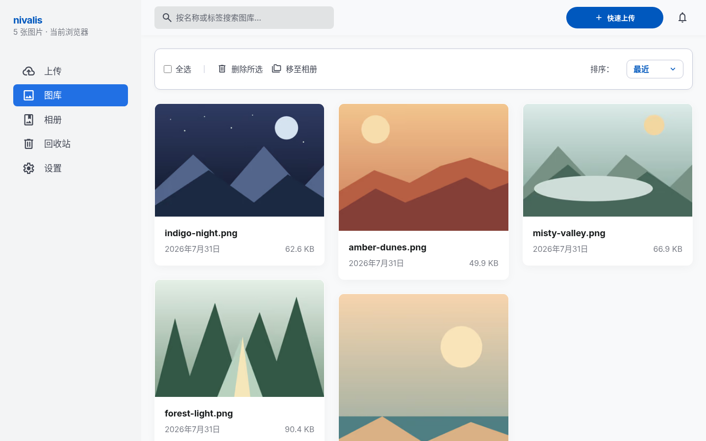

# Nivalis

一个面向公开匿名使用的 Cloudflare 原生图床：每个浏览器拥有独立图库，图片链接公开与私密并存，原图支持 Telegram 私有频道与私有 R2 桶混合存储。



## 已实现

- 拖放、文件选择和粘贴截图，3 路并发上传和逐文件进度
- 浏览器 SHA-256 去重、20 MB 上限、JPEG/PNG/WebP/AVIF/GIF
- 新图通过 Telegram Bot 按文件保存，上传后回读校验 SHA-256；已有超限图片继续保留在 R2
- 瀑布流图库、关键词检索、格式/可见性/标签筛选和批量操作
- 标题、替代文本、标签、公开/私密状态和明暗主题
- 原图或压缩 WebP 分享，一键复制 URL、Markdown、HTML、BBCode
- 简体中文、繁体中文、英语、日语；支持浏览器自动匹配和前端显式选择
- 响应式桌面与移动端界面，移动端图库使用紧凑双列概览
- `/gallery`、`/upload`、`/albums`、`/trash`、`/settings` SPA 路由，支持直达、刷新和浏览器历史记录；旧 `/images` 自动跳转到 `/gallery`
- HMAC-SHA256 私密链接，支持 1 小时至 30 天有效期及一键撤销
- 受控 `w320`、`w640`、`w1280`、`w1920` 图片变体
- 回收站、恢复后默认私密、30 天定时清理
- HttpOnly 匿名会话、浏览器级图库隔离、来源校验、上传限流、容量配额、缓存清除和结构化日志

## 架构

```text
img.nivalis.is ─ anonymous session ────┐
                                       ├─ Worker + React SPA
simg.nivalis.is ─ public/signed routes ─┘         │
                                                 ├─ D1 metadata + owner isolation
                                                 ├─ Telegram private channel / private R2 originals
                                                 └─ Images transformations
```

R2 不开放 `r2.dev`，Telegram Bot Token 与下载地址不对外暴露。公开图片和私密图片都由 Worker 校验权限后返回。匿名身份保存在 `img.nivalis.is` 的 HttpOnly Cookie 中；清除 Cookie 或更换浏览器后，无法恢复此前图库的管理权限。

## 本地开发

```bash
npm install
cp .dev.vars.example .dev.vars
npm run db:migrate:local
npm run dev
```

将 `.dev.vars` 中的 `SHARE_SIGNING_KEY` 替换为至少 32 个随机字符，填写 `TELEGRAM_BOT_TOKEN` 与 `TELEGRAM_CHAT_ID`。本地与生产环境都会自动创建匿名浏览器会话。Telegram 配置与迁移工具使用 Node.js 24.5+，支持 HTTP_PROXY/HTTPS_PROXY。

常用检查：

```bash
npm run typecheck
npm test
npm run build
npm run deploy:dry
```

完整的 Cloudflare 上线步骤见 [部署指南](./docs/deployment.md)。
Telegram 频道配置、权限检查、历史图片迁移和回退方法见 [Telegram 存储指南](./docs/telegram.md)。

## 目录

```text
src/          React 管理界面与独立 i18n 词典
worker/       Hono API、鉴权、出图和生命周期任务
migrations/   D1 数据库迁移
tests/        加密与前端组件测试
docs/         部署和运行说明
```

## 重要行为

- 原图按上传字节保存，不会自动删除 EXIF。
- 新上传最多 20 MiB（界面标为 20 MB）。历史上超过此大小的图片继续从 R2 提供，变体 URL 回退到原图。
- 私密图片的后台预览通过 `/api/media/*`，仅图片所属的匿名浏览器会话可访问。
- 默认限制为每个浏览器 500 张、1 GiB，单张 20 MB；上传同时按匿名身份与来源地址限流，频道发送通过 D1 预留共享时间槽。
- 从公开切换为私密以及移入回收站会清除全部固定变体缓存；生产环境必须配置缓存清除 Token。
- 永久删除仅允许对回收站中的图片执行。
- Telegram Bot API 只允许删除 48 小时以内的消息。永久删除会撤销网站访问并删除 R2 副本；超时的 TG 副本保留清理记录，需要频道管理员手动删除。

## License

Private project. Add a license before redistributing.
